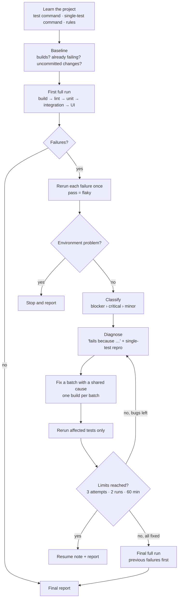

<div align="center">

# test-fix-loop

**Turn a failing test suite green with real fixes, fewer builds, and clear progress the whole way.**

A [Claude Code](https://claude.com/claude-code) skill that runs your tests, diagnoses and fixes failures in
batches, reruns only what changed, and stops at hard limits instead of looping forever.

It is a **process skill**: a disciplined method that works the same for any language, framework or platform.
Stack details are a small lookup table; project specifics come from your own scripts and `CLAUDE.md`. No
dependencies, no scripts, no network calls.

[](LICENSE)
[](https://docs.claude.com/en/docs/claude-code/plugins)
[](plugins/test-fix-loop/.claude-plugin/plugin.json)
[](https://github.com/iamrkasula/test-fix-loop-skill/actions/workflows/validate.yml)
[](#supported-stacks)

[Why](#why) · [Install](#install) · [Quick start](#quick-start) · [How it works](#how-it-works) · [Guardrails](#guardrails) · [Configuration](#configuration) · [FAQ](#faq)

</div>

---

## Why

Asking an AI agent to "fix the failing tests" tends to go wrong in predictable ways. `test-fix-loop` replaces
each of them with a disciplined routine.

| Problem | How test-fix-loop handles it |
|---|---|
| **A full rebuild and full suite after every one-line fix.** On iOS or Android that is 10–20 minutes per attempt. | Fixes are batched by shared cause with **one build per batch**; only the **affected tests** rerun. The full suite runs twice: at the start and at the end. |
| **Tests "fixed" by cheating:** deleted, skipped, assertions loosened, `sleep` added. | Strict **no-cheating rules**. Product code is fixed; a test changes only when the test itself is wrong, and the report says which one and why. |
| **Guess-fixes** that use up attempts and break other tests. | **Cause before code:** a one-line diagnosis and a single-test reproduction before any edit. A fix that breaks a passing test is reverted. |
| **Endless loops** on one stubborn bug. | **Hard limits:** 3 attempts per bug, 2 full runs, 60 minutes, then a report. |
| **Flaky tests treated as real bugs**, or real bugs dismissed as flaky. | Each failure is **rerun once in isolation**. A pass marks it flaky, logged with its likely cause. |
| **Code changed to work around the environment:** broken simulator, missing secret, network outage, signing. | **Environment problems are detected and reported**, not patched over in code. |
| **Pre-existing failures blamed on the agent.** | A **baseline** first: does it build, which tests already fail, what is uncommitted. |
| **Slow UI tests running while a compile error waits.** | **Cheapest checks first:** build → lint → unit → integration → UI. |
| **Long silences:** is it stuck or working? | **Never silent:** a start line with an estimate, a line per phase, a heartbeat about every 10 minutes, and an immediate answer to "status?". |
| **Walls of log output** that burn tokens and hide the one line that matters. | Reads **failure lines only**, one stack trace per shared error; long output stays in files. |
| **Context lost** when a session ends half-way. | Leaves a **resume note** with what is left, what was tried, and the commands to rerun. |
| **An unreviewable pile of changes**, or an accidental push. | **One commit per fix batch**, on a branch when on the default branch. Never pushes, uploads or releases. |

## Install

### As a Claude Code plugin (recommended)

```text
/plugin marketplace add iamrkasula/test-fix-loop-skill
/plugin install test-fix-loop@test-fix-loop-skill
```

### As a standalone skill

```bash
mkdir -p ~/.claude/skills/test-fix-loop
curl -fsSL https://raw.githubusercontent.com/iamrkasula/test-fix-loop-skill/main/plugins/test-fix-loop/skills/test-fix-loop/SKILL.md \
  -o ~/.claude/skills/test-fix-loop/SKILL.md
```

To scope it to a single project, place the file at `.claude/skills/test-fix-loop/SKILL.md` in that repository
instead. Restart Claude Code and confirm it appears under `/skills`.

## Quick start

Ask in plain words. The skill activates on requests such as:

```text
> run the tests and fix what fails
> get the suite green before the release
> fix the failing tests, blockers only, don't commit
```

Three modes, picked from what you ask:

| Mode | Ask | What happens |
|---|---|---|
| **Fix** (default) | "fix the failing tests", "get it green" | Full loop: run, triage, fix in batches, final run |
| **Report-only** | "why are the tests failing?", "just run them" | Runs and diagnoses, no code changes |
| **CI** | "CI is red", a PR or run link | Reads the failed CI log first, reproduces locally, then fixes |

Example progress (illustrative):

```text
▶️ Starting: scripts/test.sh on iPhone 16 simulator — 220 tests, ~25m (UI tests are slow)
🔨 Building…
✅ Build done (3m). Unit 180/180 passed. Running UI tests…
⏳ First run  ▓▓▓▓▓▓▓░░░ 30/40 UI · ❌ 2 · 14m elapsed · ~6m left
❌ First run: 212/220 passed — 1 blocker, 4 critical, 3 minor
🔁 Rerunning 8 failures once to spot flaky tests…
⚠️ SyncTests.testRetry passed on rerun — flaky (shared mock)
🔍 Diagnosing 1/7: app crashes on empty cart
🔧 Fixing 1/7: nil total when cart is empty
✅ Fixed 1/7: empty-cart crash. Related tests pass.
🛑 Gave up 6/7: CheckoutUITests.testApplePay — needs a physical device; logged
🏁 Final run started (~25m)
🏁 Final run: 219/220 passed · 2 runs · 38m
```

Every line starts with one status emoji with a fixed meaning (▶️ start · 🔨 build · ✅ passed/fixed · ⏳ heartbeat ·
❌ failed · 🔁 rerun · ⚠️ flaky/warning · 🔍 diagnosing · 🔧 fixing · 🧯 environment · 🐢 possible hang · 🛑 stopped ·
🏁 final). Ask for "no emoji" (or write to a CI log) and the same lines come as plain text with a `[####------]` bar.

Example final report (illustrative):

```text
Settings       recommended defaults
Baseline       builds ✓ · 0 tests failing before changes
Result         219/220 passed · 2 full runs · 38 min
Fixed          nil cart total → guard in CartTotals.compute (a1b2c3d)
               en_US_POSIX date formatter in ReportFormatter, 4 tests (d4e5f6a)
Tests changed  none
Flaky          SyncTests.testRetry — shared mock not reset between tests; fixed in setUp
Environment    none
Unresolved     CheckoutUITests.testApplePay — Apple Pay sheet unavailable in the simulator
```

## How it works



1. **Learn the project.** Uses the project's own test command (README, `Makefile`, `package.json`, CI config,
   `CLAUDE.md`), how to run one test by name, and how to build once and test many times.
2. **Baseline.** Records whether it builds, which tests already fail, and uncommitted changes.
3. **First run.** Cheapest layers first; stops early only for a blocker.
4. **Triage.** Reruns each failure once, separates environment problems, classifies the rest.
5. **Fix loop.** Diagnose, batch by cause, one build per batch, rerun affected tests, within the limits.
6. **Final run.** Previously failing tests first, then everything else.
7. **Report.** Short, factual, with commit hashes.

## Guardrails

The skill **never**:

- deletes, skips, disables or comments out a test;
- loosens an assertion, raises a timeout or adds a fixed delay to make a test pass;
- uses real accounts, real payments or production services;
- pushes, uploads, releases or deploys;
- changes system or security settings.

It edits a test only when the test itself is wrong (for example, an outdated expectation after an intended
change) and names that test in the report with the reason.

For UI and end-to-end failures it inspects the failure screenshot or accessibility tree first: "element not
found" is often timing, a permission dialog, the keyboard covering a control, or a renamed label. These are
fixed with waits on a condition, never fixed delays.

## Supported stacks

The project's own command always takes precedence. Built-in recipes:

| Stack | Build once, test many | Run a single test |
|---|---|---|
| Xcode (XCTest, Swift Testing) | `xcodebuild build-for-testing` → `test-without-building` | `-only-testing:Target/Class/testMethod` |
| Swift Package Manager | `swift build --build-tests` → `swift test --skip-build` | `swift test --filter Suite/test` |
| Gradle / Android | `./gradlew assembleDebugAndroidTest` | `--tests 'pkg.Class.method'` |
| Jest / Vitest | — | `-t 'test name'` |
| pytest | — | `path::Class::test_name` |
| Go | `go test -c` | `go test ./pkg -run '^TestName$'` |
| Rust | `cargo test --no-run` | `cargo test test_name` |
| Playwright | — | `npx playwright test file -g 'name'` |

## Configuration

No questions up front: the recommended settings apply unless you say otherwise in your request ("blockers
only", "3 full runs", "don't commit") or set them in your project's `CLAUDE.md`, which always takes precedence.

| Setting | Default | Alternatives |
|---|---|---|
| Fix level | All issues; minors batched at the end | Blockers and critical only · Blockers only |
| Bug still failing after 3 attempts | Log it and continue | Stop and ask |
| Full-suite runs | 2 | 3 |
| Commits | One per fix batch (new branch if on the default branch) | None |
| Time limit | 60 minutes | Any |
| Parallel runs | On where safe; UI tests serial | Off |
| Coverage | Off | On |

## Progress and reporting

- **Start:** what is running, where, how many tests, and a rough duration.
- **Phases:** one line as each layer or phase starts and ends.
- **On change:** an immediate line when a phase starts or ends, a test fails, a device is lost, the run
  finishes, or nothing has moved for unusually long (possible hang).
- **Heartbeat:** during any run longer than about 5 minutes, one line about every 10 minutes or every 25% of
  tests, read from the live log by a background watcher, so updates arrive even while tests are running.
- **Fixes:** one line before and after each batch.
- **On demand:** "status?" gets an immediate answer.
- **Final report:** settings, baseline, pass count, runs and time used, fixes with commits, tests changed,
  flaky tests, environment issues, unresolved failures.

No raw logs or code are pasted into progress updates.

## FAQ

<details>
<summary><b>Does it write new tests?</b></summary>

No. It makes your existing tests pass with real fixes. It doesn't add tests, measure coverage gaps or run load
tests.
</details>

<details>
<summary><b>What happens if it stops before everything passes?</b></summary>

It writes `.test-fix-loop.md` in the project root (not committed) with the remaining failures, suspected
causes, what was tried, and the exact commands to rerun them. A later session continues from there.
</details>

<details>
<summary><b>Will it change my code without asking?</b></summary>

It edits code to fix failing tests, which is what you asked for, and commits once per batch so every change is
easy to review or revert. It never pushes. Say "don't commit" to keep everything uncommitted.
</details>

<details>
<summary><b>Is it only for mobile apps?</b></summary>

No. It was shaped by iOS work, where builds are slow and UI tests are flaky, but the routine is stack-agnostic:
web, backend, CLI tools and libraries all work.
</details>

<details>
<summary><b>How does it handle flaky tests?</b></summary>

Each failure is rerun once by name. A pass on rerun marks it flaky (treated as minor), and the skill still looks
for the cause: timing, shared state or test order. Every flaky test is listed in the report.
</details>

<details>
<summary><b>Does it send any data anywhere?</b></summary>

No. It is a single instruction file with no scripts, hooks or network calls. It runs your project's own test
commands on your machine.
</details>

## Repository layout

```text
.claude-plugin/marketplace.json                          Plugin marketplace manifest
plugins/test-fix-loop/.claude-plugin/plugin.json         Plugin manifest
plugins/test-fix-loop/skills/test-fix-loop/SKILL.md      The skill (short core)
plugins/test-fix-loop/skills/test-fix-loop/references/   Stacks & CI, progress & watcher, state & report (loaded on demand)
.github/workflows/validate.yml                           Manifest and structure checks on every push
CHANGELOG.md                                             Release notes
```

## How it's tested

Before each release the skill runs against a private test suite at three levels, with no language toolchains,
devices or CI servers:

| Level | Covers |
|---|---|
| **On paper** (35 cases) | When it triggers and when it doesn't, single-test commands for 8 stacks (pytest, Jest, XCTest, Go, Rust, Gradle, Playwright, SwiftPM), every rule, progress format, final report |
| **Real runs** (11 cases) | The loop running against a generic fake test runner: fixes, report-only, flaky tests, hangs, a device lost mid-run, lint first, a busy device, CI logs, an unfixable case with a resume note, heartbeats, estimates |
| **Live git** (4 scenarios) | New branch and commits, "don't commit", already-failing baseline, separate worktree; the state file is never committed |

Graders check meaning, not exact wording. The test suite is kept out of the plugin so nothing extra is
installed on your machine.

## Contributing

Issues and pull requests are welcome, especially new stack recipes and real cases where the skill made the
wrong call. Please include the stack, the request you gave, and what happened.

## License

[MIT](LICENSE) © 2026 Rajesh Kasula
